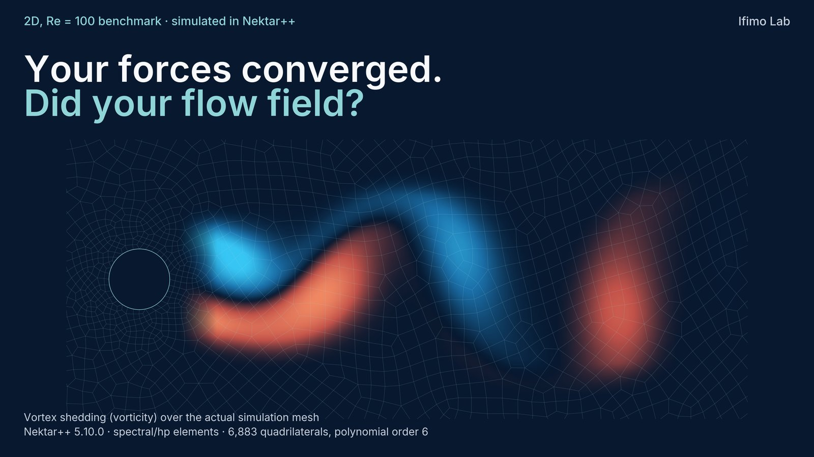
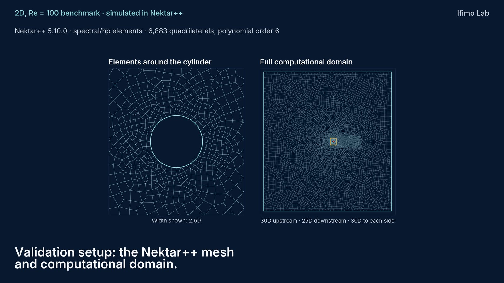
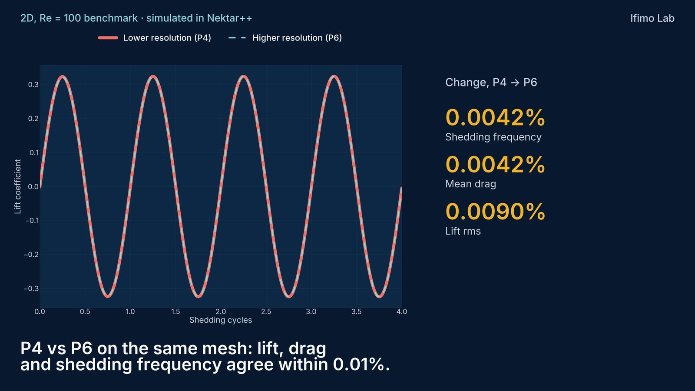
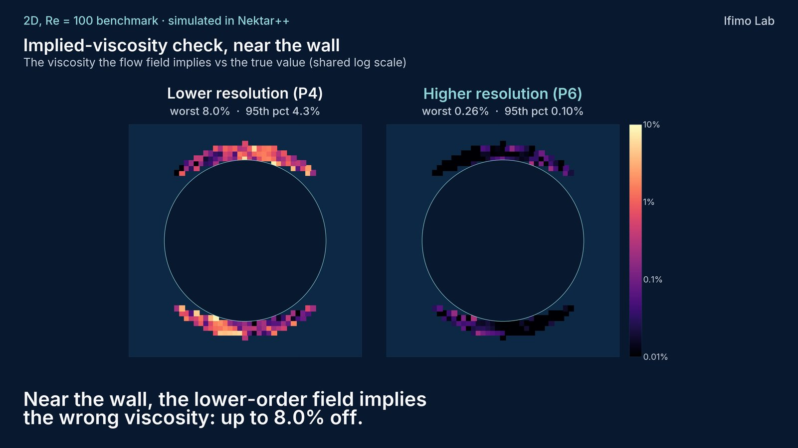
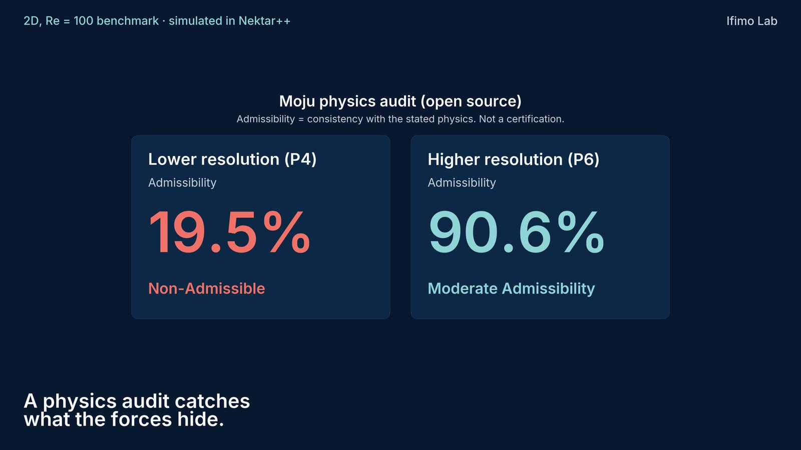

# Case study: converged forces, unconverged near-wall physics

*2D flow past a circular cylinder at Re = 100, simulated in Nektar++. Audited with Moju.*



## TL;DR

- We ran the same mesh at polynomial order 4 and 6. Lift, drag and shedding frequency agree within 0.01%. By the usual convergence check, the two runs are the same.
- Moju's implied-viscosity check says otherwise. Near the wall, the order-4 field behaves as if the fluid's viscosity were wrong: 4.3% off at the 95th percentile and 8.0% at the worst point, against 0.10% and 0.26% at order 6.
- Moju scores the order-4 field 19.5% (Non-Admissible) and the order-6 field 90.6% (Moderate Admissibility).
- A convergence study only tells you whether two runs agree with each other. A physics audit tells you whether each one satisfies the physics. That matters when simulation fields become training data for neural surrogates: a model trained on near-wall errors learns them too, right where the wall shear and pressure that make the forces come from.

## Setup

| Item | Value |
|---|---|
| Solver | Nektar++ 5.10.0, `IncNavierStokesSolver` (spectral/hp elements) |
| Flow | 2D, incompressible, Re = 100 (D = 1, U = 1, ν = 0.01), unconfined, settled periodic shedding |
| Mesh | 6,883 quadrilaterals, identical for both runs |
| Resolutions | polynomial order 4 (`NUMMODES=5`) and 6 (`NUMMODES=7`), i.e. p-refinement on the same mesh |
| Domain | 30D upstream, 25D downstream, 30D to each side |



## What converged

Statistics over the settled window:

| Quantity | Order 4 | Order 6 | Change |
|---|---:|---:|---:|
| Strouhal number (zero-crossing) | 0.16524 | 0.16523 | 0.0042% |
| Mean drag coefficient | 1.33446 | 1.33451 | 0.0042% |
| RMS lift coefficient | 0.22940 | 0.22938 | 0.0090% |



## What the audit checks

Moju turns each predicted state into residuals of the governing laws you declare and into **law-linked constitutive checks** ([docs](../law_implied_audits.md)). For incompressible Navier–Stokes, the constitutive check asks: *what viscosity does the local momentum balance imply at this point, and does it match the viscosity you declared?*

- At each sample point, Moju solves the momentum balance for a local viscosity ν̃ (a least-squares projection onto ∇²u) and computes the fractional mismatch δ = (ν − ν̃)/ν.
- It only uses points where the viscous term is large enough for ν to be identifiable. Elsewhere, inertia or pressure dominate and the implied value is ill-conditioned, so those points are reported as not identifiable, not scored. Near the wall that leaves 156 of 380 samples at both orders.
- The score uses the 95th percentile of |δ| with noise normalization (the opt-in `implied_metric="percentile"` setting, added in Moju 2.2.0). The worst point is reported alongside it but does not set the score.

The fields passed to Moju are the solver's own output: velocity and pressure at five closely spaced snapshots (for ∂u/∂t), and spatial derivatives from Nektar++'s `FieldConvert`.

## Results

| | Order 4 | Order 6 |
|---|---:|---:|
| Implied-viscosity mismatch, 95th percentile | 4.3% | 0.10% |
| Implied-viscosity mismatch, worst point | 8.0% | 0.26% |
| Moju admissibility (implied viscosity) | **19.5%, Non-Admissible** | **90.6%, Moderate** |





Two things are worth noting:

- **The governing laws look fine at both orders.** Near-wall continuity and momentum residuals score High (about 0.95 to 1.00). The problem only shows up when you ask whether the field's viscous balance matches the stated fluid.
- **A global summary hides it.** The median implied viscosity over the identifiable near-wall points is 0.009998 at order 4 and 0.010000 at order 6, both essentially the declared 0.01. The error is local, and a central summary washes it out.

## Why we care

We are generating simulation data intended for training specialized neural surrogates. Integrated quantities such as forces and frequencies are the usual convergence criteria, and they converge long before the near-wall derivatives do. A surrogate learns the whole field, so the data has to be right where the physics is hardest, not only where the integrals are.

## Limitations

- This is one benchmark: 2D, laminar, Re = 100. Nothing here is a claim about 3D, turbulent or high-Reynolds-number flow.
- A tier means consistency with the stated physics on the sampled points. It is not a certification and does not replace validation against experiments.
- Moderate at order 6 is not "perfect": on Moju's scale, High starts at 90.9%.
- Scores were computed with Moju 2.3.2 and re-checked with 2.4.2 (strict evaluation coverage), with identical outcomes.
- We are verifying the audit pipeline itself against exact Navier–Stokes solutions sampled through the same mesh and derivative path. A steady exact solution (Kovasznay flow) passes; an unsteady check (Taylor–Green) is still being worked through. Both orders go through the same pipeline, so any pipeline effect applies equally to both. We will update this page when the check is complete.
- The simulation fields themselves are not published in this repository.

## Try it on your own fields

```bash
pip install moju
```

- Law-linked implied audits: [`docs/law_implied_audits.md`](../law_implied_audits.md)
- Auditing CFD snapshots: [`examples/cfd_snapshot_cookbook_heat_1d.py`](../../examples/cfd_snapshot_cookbook_heat_1d.py)
- Navier–Stokes term diagnostics: [`examples/cookbook_taylor_green_diagnostics.py`](../../examples/cookbook_taylor_green_diagnostics.py)
- Getting derivatives right: [`docs/getting_derivatives_right.md`](../getting_derivatives_right.md)

Simulations and case study by Ifimo Lab. Questions and critique are welcome in [Issues](https://github.com/IfimoAI/moju/issues).
